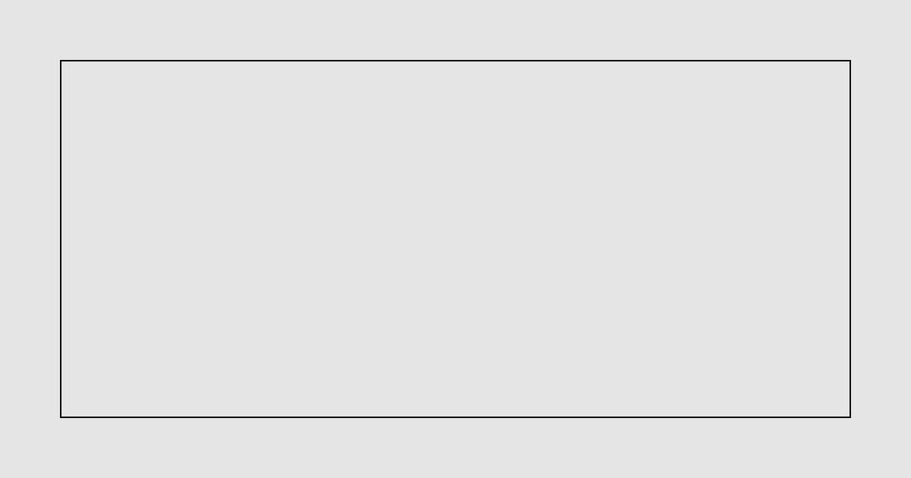

This file is an unpublished format sample for the Local Cascade blog. It is not a client story and not a published article. Reference token UNPUBLISHED_FORMAT_SAMPLE_8f3c1a.

## What a post can contain

A paragraph with a [link to services](/services) and **emphasis** where a sentence needs it.

- A plain point about a firm's website
- A second point, still general

> A short aside, in the same calm voice as the rest of the note.

An image needs alt text. This one is only here so the file shows the shape.

